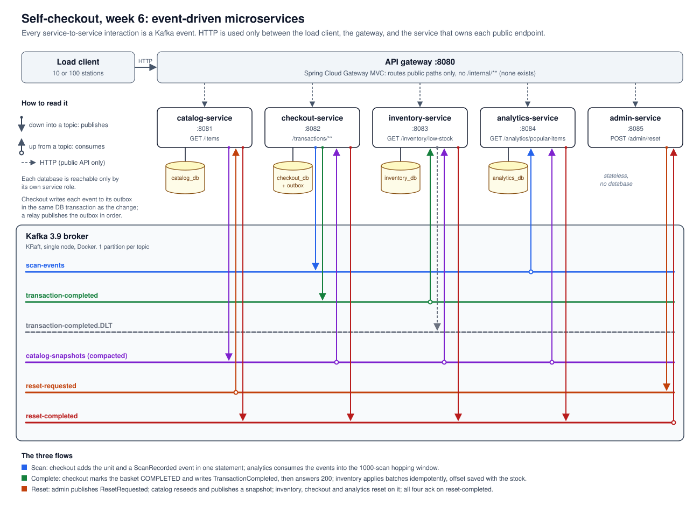

# Assignment 6: Event-Driven Architecture

Self-checkout backend in Spring Boot, PostgreSQL and **Kafka**. It implements `reference-repo/spec/self-checkout-openapi.yaml`, so the unmodified reference load client runs against it.

Week 5 split the system into microservices with a database each, but they still called each other over HTTP. This week **every interaction between services is an event on Kafka**. No service makes an HTTP call to another, and the `/internal/**` endpoints are gone. The only HTTP left is the public API: load client → gateway → the service that owns the endpoint.



## What changed from week 5

| Interaction | Week 5 (HTTP) | Week 6 (event) |
|---|---|---|
| Completing a basket takes stock out | checkout → `POST /internal/stock-commits` on inventory, inside a 3-step saga | checkout writes `TransactionCompleted` to its outbox; inventory consumes `transaction-completed` |
| Reset between runs | admin → `POST /internal/reset` on each service, in order | admin publishes `ResetRequested`; catalog reseeds and publishes a `CatalogSnapshot`; the others reset on it; all ack on `reset-completed` |
| Prices and names for other services | `GET /items` from catalog at startup and on reset | the compacted `catalog-snapshots` topic |
| Scans → analytics | outbox → Kafka `scan-events` | unchanged, now in the common event envelope |

## Services

| Service | Port | Owns (database) | Public endpoint | Publishes | Consumes |
|---|---|---|---|---|---|
| **catalog-service** | 8081 | `catalog_db`: `items`, `catalog_state` | `GET /items` | `catalog-snapshots`, `reset-completed` | `reset-requested` |
| **checkout-service** | 8082 | `checkout_db`: `transactions`, `transaction_items`, `outbox`, `relay_state` | `/transactions/**` | `scan-events`, `transaction-completed` (both via outbox), `reset-completed` | `catalog-snapshots` |
| **inventory-service** | 8083 | `inventory_db`: `inventory`, `stock_commits`, `stock_commit_lines`, `stock_shortfalls`, `low_stock_alerts`, `inventory_state` | `GET /inventory/low-stock` | `transaction-completed.DLT`, `reset-completed` | `transaction-completed`, `catalog-snapshots` |
| **analytics-service** | 8084 | `analytics_db`: `popular_item_windows`, `popular_item_entries`, `analytics_state` | `GET /analytics/popular-items` | `reset-completed` | `scan-events`, `catalog-snapshots` |
| **admin-service** | 8085 | *none* (stateless) | `POST /admin/reset` | `reset-requested` | `reset-completed` |
| *API gateway* | 8080 | *none* | routes the public paths above | | |

**Broker:** Kafka 3.9 in Docker (KRaft, single node). Each topic has one partition (see "Ordering").

| Topic | Event | Notes |
|---|---|---|
| `scan-events` | `ScanRecorded{sku}` | one per scanned unit, about 91% of all traffic |
| `transaction-completed` | `TransactionCompleted{transactionId, stationId, lines[]}` | keyed by transaction id |
| `transaction-completed.DLT` | the original record, plus `x-reason` / `x-source-offset` headers | completions inventory can never apply |
| `catalog-snapshots` | `CatalogSnapshot{stockPerItem, items[]}` | **compacted**, single key, 10 MB message limit |
| `reset-requested` | `ResetRequested{catalogSize, stockPerItem}` | |
| `reset-completed` | `ResetCompleted{service, ok, error, elapsedMs}` | keyed by service |

Every record uses the same JSON envelope, `{eventId, type, epoch, seq, occurredAt, payload}` (`common/.../contract/Events.java`):
- **`epoch`** is the reset the producer was in. Consumers drop events from an older epoch, so events still in flight when a reset happens are discarded cleanly.
- **`seq`** is checkout's outbox sequence number. Consumers use it to detect redeliveries.

### How the boundaries are enforced

- **Database:** as in week 5, each role owns its database and `CONNECT` is revoked from everyone else.
- **Build:** no service module depends on another. `common` holds the HTTP DTOs, the event records, error handling and the Kafka plumbing (`KafkaPollLoop`, `CatalogFeed`, `EventCodec`).
- **Architecture tests** (`architecture-tests/ServiceBoundariesTest`, ArchUnit), new this week:
  - **nothing** in the codebase depends on an HTTP client (`java.net.http`, `RestClient`, `WebClient`, …);
  - no controller maps a path under `/internal`;
  - each service references exactly the topics in the table above. `Topic` is an enum, not string constants, so the compiler does not inline the names and the test can see every use.

## Running it

All commands run from `server/`. You need JDK 21, Maven, PostgreSQL and Docker Desktop.

```bash
cp .env.example .env && $EDITOR .env    # set DB_PASSWORD and SERVICE_DB_PASSWORD
./scripts/create-db.sh                  # one database + one role per service (idempotent)
./scripts/kafka-up.sh                   # Kafka in Docker; creates all six topics
./scripts/build-all.sh                  # 83 tests + one -exec.jar per service
./scripts/run-all.sh                    # start everything, then a reset
```

If the Kafka container is left over from week 5, recreate it first with `./scripts/kafka-down.sh && ./scripts/kafka-up.sh`. Its `scan-events` records use the old message format.

**Load tests** (reset between runs):

```bash
./scripts/run-load-test.sh                                                          # default: 10 stations, 60s
./scripts/reset-db.sh && ./scripts/run-load-test.sh --stations=100 --duration=120   # stress
./scripts/verify.sh                                                                 # after each run
```

`verify.sh` first waits for both event feeds to drain:
- checkout's outbox relay has published everything;
- inventory's saved offset equals the end of `transaction-completed`;
- analytics' window count has stopped moving.

Then it checks every database.

## Load-test results

| Run | Report | Transactions | Scans | Errors | Scan p50 / p99 | Complete p50 / p99 |
|---|---|---|---|---|---|---|
| Default (10 stations, 60s) | [`server/reports/report-week6-default-10stations-60s.json`](server/reports/report-week6-default-10stations-60s.json) | 31,697 | 333,109 | **0** | 1.19 / 6.05 ms | 1.66 / 8.01 ms |
| Stress (`--stations=100 --duration=120`) | [`server/reports/report-week6-stress-100stations-120s.json`](server/reports/report-week6-stress-100stations-120s.json) | 67,523 | 706,580 | **0** | 10.76 / 95.04 ms | 11.79 / 131.57 ms |

After each run, `verify.sh` reported:
- No negative stock.
- **inventory_db on its own:** `initial − stock == Σ fulfilled` for every SKU (zero failing rows).
- **Exactly-once application of completion events:**
  - for every SKU, the units inventory applied equal the units checkout sold (zero failing rows);
  - the number of `stock_commits` equals the number of completed transactions (31,697 and 67,523);
  - nothing was dead-lettered.
- **Stock accounting:** `initial − final == completed line items − shortfall` (zero failing rows).
- **Scan feed:**
  - scan events in the outbox equal units in baskets (333,109 and 706,580);
  - no sequence gaps, and the relay published all of them;
  - analytics persisted exactly `scans / 500` windows (666 and 1,413);
  - all three services that hold run state are in the same epoch.
- Both feeds had drained by the time `verify.sh` first checked, seconds after the run ended. I did not measure consumer lag *during* the runs.

### Compared with week 5 (synchronous HTTP between services)

| Run | Transactions/s | Scan p50 | Scan p99 | Complete p50 | Complete p99 |
|---|---|---|---|---|---|
| Default | 496.3 → **528.1** (+6%) | 0.97 → 1.19 ms | 2.98 → 6.05 ms | 7.00 → **1.66 ms** | 21.55 → **8.01 ms** |
| Stress | 470.7 → **562.3** (+19%) | 1.09 → 10.76 ms | 5.27 → 95.04 ms | 181.6 → **11.79 ms** | 416.5 → **131.57 ms** |

- **Completing a basket got much cheaper.** In week 5, `/complete` had three steps across two databases, with an HTTP call to inventory in the middle. Every completion also queued on the row lock of the hottest SKU, which is in most baskets. Now `/complete` is one local transaction: mark the basket sold and write the event. Inventory takes the stock out afterwards, one batch at a time on a single consumer. It sums the batch's demand per SKU, so the hot row is updated once per batch instead of once per basket.
- **Throughput rose, and under stress the bottleneck moved.** The completion-row queue that capped both weeks 4 and 5 at roughly 470–495 tx/s is gone. Stations now cycle faster, so all 100 of them spend their time on scans. The load client is closed-loop, so latency settles where Little's law puts it: 100 stations ÷ about 6,400 requests/s ≈ 15 ms. Scan latency under stress therefore rose, even though scan *throughput* rose too (4,953 → 5,884 scans/s). The machine itself is now the limit: a CPU sample during the default run showed the gateway at about 270% CPU and checkout at about 110%, all on one laptop alongside Postgres, Kafka and the load client.
- **One caveat on the default number.** My first default run, before I stopped the outbox relay re-parsing each payload's JSON (`EventCodec.encodeRaw`), reached 409.8 tx/s. The submitted run is the one after that change. I think part of the gap between them is ordinary run-to-run variance on a busy laptop, not the change alone.

## The three flows

### 1. Scan → analytics (choreography through the outbox)

- One statement in `checkout_db` updates the basket counters, upserts the basket line, and inserts a `ScanRecorded` row into `outbox`. A scan therefore reaches the analytics feed exactly when it reaches a basket: never lost, never invented.
- `OutboxRelay` publishes outbox rows to their topics in `seq` order, using an idempotent producer with `acks=all`. It saves its position only after Kafka acknowledges the batch (at-least-once). It publishes only contiguous runs of `seq`, so a slow-committing insert cannot be skipped.
- `ScanConsumer` drops redelivered `seq`s and events from older epochs. It keeps its topic offset in `analytics_db`, so a restarted analytics-service replays the run and rebuilds its window.

### 2. Complete → inventory (fire-and-forget, consumed idempotently)

```
POST /complete ─► checkout_db, one transaction:
                    UPDATE transactions SET status='COMPLETED' WHERE id=? AND status='OPEN' AND item_count>0
                    INSERT INTO outbox (... 'TransactionCompleted', lines as JSON ...)
               ─► 200 + receipt
outbox relay ─► transaction-completed ─► inventory CompletionConsumer, per poll (up to 2,000 records):
                    one inventory_db transaction: claim ids, take stock, write audit rows, save next offset
```

**Why checkout doesn't wait for inventory.** Under the clamp-and-audit stock policy, inventory never refuses a basket. The receipt contains nothing inventory owns. Every SKU was already validated against the catalog at scan time. So inventory could never change the answer, and waiting for it would add latency for nothing. Week 5's `COMPLETING` state, saga, retry client and recovery sweeper are all deleted.

**Exactly-once effect from an at-least-once feed:**
- **Offset in the database.** Inventory stores its next `transaction-completed` offset in `inventory_state`, in the same transaction as the stock changes. A crash rolls back both together. On restart it seeks to the saved offset, so it can neither skip a record nor apply one twice.
- **Idempotency key.** `stock_commits` is keyed by transaction id. If the relay republishes a batch that Kafka had in fact stored, the duplicate records are recognised and skipped. Duplicates inside one batch are collapsed too.

**How each record is handled:**

| Record | What inventory does |
|---|---|
| older epoch | dropped |
| newer epoch (checkout reset before inventory) | partition rewound to it and paused until inventory's own reset arrives |
| malformed, or names a SKU inventory has no row for | sent to `transaction-completed.DLT`, so it doesn't block the partition |
| anything else | added to the batch |

**Tested live:** I stopped inventory-service and completed a basket. `/complete` returned **200 in 5 ms**; in week 5 the same situation returned a 503. When inventory restarted, it resumed from its saved offset and applied the sale.

The cost is that `GET /inventory/low-stock` is now **eventually consistent**, behind by however long the consumer takes to reach the latest completion. The spec doesn't promise read-your-writes there.

### 3. Reset (a choreographed chain)

```
POST /admin/reset
  admin: position a consumer at the end of reset-completed, then publish ResetRequested(epoch)
    ─► catalog:   reseed catalog_db, publish CatalogSnapshot(epoch), ack
          ─► inventory: reseed stock from the snapshot, ack
          ─► checkout:  wipe its tables and outbox, move the relay to the epoch, swap in the replica, ack
          ─► analytics: wipe its windows, start the epoch at its current offset, swap in the replica, ack
  admin: once all four acks for this epoch are in, return 200
         (a failed ack returns 503 naming the service; 30 s without one returns 503 naming who is missing)
```

- **Ordering is built into the chain.** Week 5's admin had to call catalog first. Now the other three react to catalog's snapshot, not to admin's request, so they can never reseed from a stale catalog.
- **Ordering between checkout and analytics no longer matters.** Week 5 needed analytics to reset before checkout. Now, if checkout resets first and publishes new-epoch scans, analytics adopts the new epoch from the scan stream itself, and the snapshot that follows is a no-op that is still acknowledged. Inventory pauses instead, as described above.
- **Observed timing:** a reset takes about 0.7 s end to end (catalog 43 ms, inventory 58 ms, checkout and analytics 23 ms each).
- The load client never calls `/admin/reset`, so reset latency does not affect the graded reports.

### Catalog replication

- `catalog-snapshots` is compacted under a single key, so it always holds the latest catalog.
- A starting service reads the topic from the beginning but handles only the newest record. If that record is from a newer epoch than the service's database, the service was down through a reset, so it resets now and catches up.
- catalog-service republishes its snapshot at startup. That fills the topic on first run, and repairs a crash between reseeding and publishing.
- No service needs catalog-service to be *up* in order to start; it only needs the topic.

## Ordering

Every topic has one partition. For `scan-events` this is required: the popularity window is "the most recent 1000 scans", which needs one global order, and Kafka orders records only within a partition. For `transaction-completed`, one partition with one batching consumer is enough: inventory keeps up easily, and was fully drained seconds after the stress run. Partitioning by transaction id is the path to scale it out, because stock decrements are commutative. The other topics carry a handful of events per reset.

## Concurrency: no overselling

Stock is written only by inventory's consumer, and each batch's demand is taken out in **one** statement:

```sql
WITH demand AS (SELECT * FROM unnest(?::text[], ?::int[]) AS d(sku, qty)),
     locked AS (SELECT i.sku, i.stock FROM inventory i JOIN demand d USING (sku)
                ORDER BY i.sku DESC FOR UPDATE OF i)
UPDATE inventory i SET stock = locked.stock - LEAST(locked.stock, d.qty)
  FROM locked JOIN demand d USING (sku) WHERE i.sku = locked.sku
RETURNING i.sku, locked.stock AS before, i.stock AS after;
```

- **The clamp is the rule.** `LEAST(stock, demand)` means a decrement can never exceed what is there. `CHECK (stock >= 0)` stays on the column as a backstop.
- **It stays safe with more than one writer.** `FOR UPDATE` waits for any concurrent writer, then, under READ COMMITTED, returns the row's newest committed version. So the new stock is always computed from current data, not from a stale snapshot. Locks are taken in descending SKU order, as in week 5, so two writers could not deadlock.
- **Units are handed out in topic order.** The units actually taken go to the batch's transactions first come, first served. Where a SKU runs out partway through a batch, the later transactions record a shortfall.

## Overselling and stock exhaustion

Unchanged from week 5. The contract gives `/complete` no out-of-stock error, so a sale always completes. Stock is held at zero rather than going negative, and every unfulfilled unit is recorded in `stock_shortfalls`, so this always holds:

```
initial_stock - final_stock == completed_line_items - unfulfilled
```

In the stress run, `SKU-000001` alone was in 86,181 sold units against 10,000 in stock.

## Contract details that are easy to break

- `GET /items` returns `ORDER BY sku`. The load client uses list position as the Zipf rank.
- `POST /transactions` returns **201**.
- `/complete` receives a literal `{}`, so no request body is bound.
- Errors use `{error, message}`. `DEPENDENCY_FAILED` (503) remains for a scan that arrives before checkout has received any catalog snapshot, and for a failed reset.
- Money is `NUMERIC`/`BigDecimal` end to end.

## Configuration

| Property | Service | Default | Meaning |
| --- | --- | --- | --- |
| `KAFKA_BOOTSTRAP_SERVERS` | all five | localhost:9092 | broker |
| `app.reset.timeout-ms` | admin | 30000 | how long admin waits for the four acks |
| `app.reset.participants` | admin | the four data services | whose acks complete a reset |
| `app.catalog-size` / `app.stock-per-item` | admin | 2000 / 10000 | reset defaults; both can be overridden per request |
| `app.low-stock-threshold` | inventory | 50 | default threshold for `/inventory/low-stock` |
| `app.popularity.window-size` / `slide-interval` | analytics | 1000 / 500 | hopping window |
| `DB_POOL_SIZE` | per service | checkout 32, inventory 4, analytics 4, catalog 2 | Hikari max pool size |

Week 5's `CATALOG_URL`, `INVENTORY_URL` and the saga retry and recovery settings are gone: no service needs to know where another one lives.
